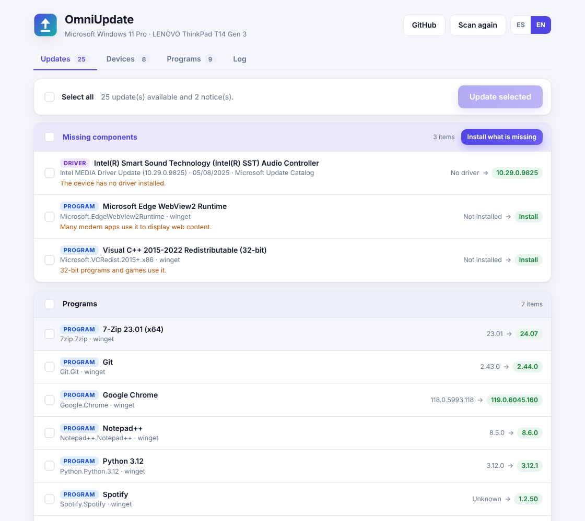

<p align="center"></p>
<h1 align="center">OmniUpdate</h1>
<p align="center"><b>One window to find and fix everything that is out of date on a Windows PC:<br>drivers, programs, Windows, plugins, GitHub apps and Git repositories.</b></p>
<p align="center">Bilingual interface: English · Español</p>

<p align="center"></p>

## Why

Windows Update only covers a part of what a PC needs. OmniUpdate scans the whole machine, shows **only what is wrong** in a simple list, and lets you tick what you want (or press **Select all**) and install it. It does the downloading and installing by itself: you are never sent to a vendor website.

## What it checks

| Area | How |
|---|---|
| **Programs** | `winget` (parsed in a language-independent way, with a fallback to the official WinGet PowerShell module) |
| **Windows & Office** | Microsoft Update (not only Windows Update) |
| **Drivers** | Microsoft Update plus the **Microsoft Update Catalog**, searched per hardware ID, so drivers Windows Update skips are found |
| **Manufacturer** | Dell Command Update, Lenovo System Update and HP Image Assistant (installed automatically); **ASUS** drivers straight from ASUS's feed (SHA-256 and Authenticode checked). MSI has no safe silent channel, so MSI machines rely on Microsoft Update + the Catalog |
| **Plugins** | VS Code / VSCodium extensions, global npm packages, Chocolatey packages |
| **GitHub programs** | Detects installed programs whose website is on GitHub, and lets you watch any `owner/repo`; installs MSI, installers or portable zips from the latest release |
| **Git repositories** | Finds your local clones and fast-forwards them with `git pull --ff-only` (never merges, never touches local changes) |
| **Missing components** | Devices with no driver get one searched automatically; Visual C++ runtimes, .NET Desktop Runtime and WebView2 are offered when absent. **Install what is missing** does it in one click |

Everything runs without windows or prompts, a restore point is created before drivers or system updates, and the app tells you when a restart is needed.

## Install

1. Download **`OmniUpdate-Setup.exe`** from the [Releases](../../releases) page.
2. Double-click it. It asks for administrator permission, installs to *Program Files*, and creates the Start-menu and desktop shortcuts. Older "Actualizador PC" versions are removed.
3. Open **OmniUpdate**, press **Check for updates**, tick what you want and press **Update selected**.

Requirements: Windows 10 (1809+) or Windows 11, internet access. Uninstall from *Settings → Apps*.

## Language

OmniUpdate starts in your Windows language (Spanish or English). Switch any time with the **ES / EN** buttons, with no rescan.

## Build from source

Needs [Go](https://go.dev/dl/) 1.24+. The build cross-compiles, so it works from Windows, Linux or macOS:

```bash
./build.sh 1.2.0        # → dist/OmniUpdate.exe and dist/OmniUpdate-Setup.exe
make test               # unit tests (any OS)
make demo               # UI with sample data, no changes to your system
```

The installer is a single self-contained executable that embeds the app. Both `.exe` files carry the app icon, version info and manifest (generated by `tools/mkres`, no external tools needed).

## Project layout

```
cmd/omniupdate/         the app: scanner, installers, local web server, embedded UI (ui/)
cmd/omniupdate-setup/   the single-file installer
internal/sys/           Windows helpers (elevation, single instance, processes)
tools/genicon/          generates the icon (PNG + multi-size ICO)
tools/mkres/            generates the Windows resource file (.syso)
docs/                   architecture notes and screenshots
```

See [docs/ARCHITECTURE.md](docs/ARCHITECTURE.md) for how the pieces fit together.

## Honest limitations

- Developed and unit-tested on Linux (cross-compiled, `go vet` for Windows); it has not been verified on every Windows version or PC model. If something fails, use **Copy technical report** and open an issue.
- ASUS support depends on ASUS's public feed and may not resolve every non-ROG model.
- Drivers and BIOS updates always carry some risk; that is why a restore point is created first.

## Contributing & security

See [CONTRIBUTING.md](CONTRIBUTING.md) and [SECURITY.md](SECURITY.md). Licensed under the [MIT License](LICENSE).
